  

<em>Every project is a small spell. Some take an afternoon to learn, others a few hundred years.</em>

  
  

## 🌙 About the traveler

I'm **Wayne Wen**, a backend-focused Computer Science student at the **University of Waterloo** (AI specialization, Combinatorics & Optimization minor, class of 2028). I work on AI operations, cryptographic infrastructure and distributed systems, and I usually end up teaching a program to play a game along the way.

## 🧭 The journey so far

| When | Where | What I worked on |
| :-- | :-- | :-- |
| Sep 2026 – Present | **Amazon**, SDE Intern (Prime Tech) | A multi-agent incident analysis system that correlates AWS telemetry and gives on-call engineers evidence-backed reports |
| May – Aug 2026 | **BitGo**, Software Engineer Intern (Wallet Core) | WebAuthn intent attestation that binds transactions to passkey signatures across wallet withdrawal flows |
| Sep – Dec 2025 | **Emailgistics**, Senior Software Engineer Intern | Go microservice features, concurrent report generation and alerting APIs |
| Jan – Apr 2025 | **Supernova MGU**, AI Software Engineer Intern | A RAG-based content agent and automated broker onboarding |
| Sep – Dec 2024 | **Caribou Contest**, Full Stack Developer Intern | Higher throughput for the mass-email delivery program |

## 📖 Spells I've learned

**Languages**

**Backend and frontend**

**Cloud and data**

**AI**

## 🌼 Grimoires

| Project | What it does | Built with |
| :-- | :-- | :-- |
| [**2048-Auto**](https://github.com/mr-neptune/2048-Auto) | A TD(λ) CNN agent with expectimax search that reaches the 8192 tile in 52% of test games and 4096 in 94.8%. [Watch it play](https://mr-neptune.github.io/2048-Auto/). | Python, TensorFlow, Keras |
| [**fantasy_cracker**](https://github.com/mr-neptune/fantasy_cracker) | An autopilot for 9-category fantasy basketball that combines ML projections, Claude's reading of the news and 2,000-run matchup simulations. | Python, Docker |
| [**WebWhisper**](https://github.com/mr-neptune/WebWhisper) | A multi-provider AI agent in a browser side panel for YouTube, Reddit, LinkedIn and Instagram. | TypeScript, Go |
| [**Sidechat**](https://github.com/mr-neptune/llm-btw) | A chat UI with side questions, conversation forking and rewind. | React, TypeScript, FastAPI |
| [**Chamber Claw 3000**](https://github.com/mr-neptune/cc3k) | A text-based dungeon crawler built around object-oriented design. | C++ |

## ✨ Trials passed

Top 0.5% in the CEMC CSMC (2021, 2022) · Top 1% in the AMC 12 (2021, 2022) · Top 5% in the Euclid Contest (2023)

<em>Thanks for stopping by on your journey.</em>

Banner is original fan-inspired artwork. Not affiliated with any anime or its creators.

